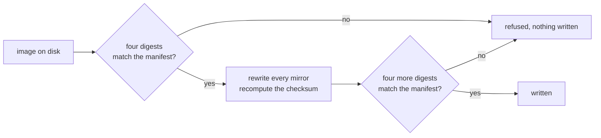
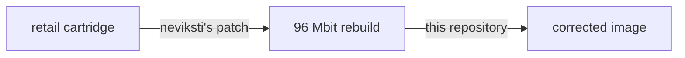

# Star Ocean、チップなし：ヘッダーの修正

nevikstiによる2つの96 Mbit版Star Oceanリビルドのためのヘッダー修正です。市販カートリッジから修正済みイメージまでのすべてのファイルを、4つの固定ダイジェストで照合します。

[English](README.md) | 日本語 | [简体中文](README.zh-Hans.md) | [繁體中文（香港）](README.zh-HK.md)

[](https://github.com/gufranco/snes-star-ocean-nochip-fix/actions/workflows/ci.yml)
[](https://github.com/gufranco/snes-star-ocean-nochip-fix/releases)
[](LICENSE)

**2**つのエディション、イメージごとに変更されるのは**12**バイトでそれ以外は変更なし、2つのチェーン全体で**32**個の固定ダイジェスト、不一致**0**件、**616**件のテスト、ステートメントとブランチの**100%**カバレッジ、依存関係なし

```python
import tempfile
from pathlib import Path

from starocean import EDITIONS, look, report, verdict

with tempfile.TemporaryDirectory() as where:
    (Path(where) / "Star Ocean (Japan).sfc").write_bytes(b"a different file")
    found = look(where, EDITIONS, where)

for line in report(found)[:4]:
    print(line)
print(verdict(found))
```

```
  japanese: source altered, Star Ocean (Japan).sfc (found 455314660dc0a594)
  japanese: patch absent, 96Mbit_SO_JPN.xdelta
  japanese: reads absent, Star Ocean (J) SDD1 Patched (Hack) v1 Neviksti.sfc
  japanese: writes absent, star-ocean-jp-nochip.sfc
wrong
```

この例では、日本の市販カートリッジの名前で内容の異なるファイルを置き、そこに何があるかを問い合わせます。`look`はファイルを見つけてダイジェストを計算し、見つかったsha256の先頭16桁の16進数とともに`altered`として報告します。日本語版チェーンの残り3つのリンクは存在しないため、`absent`と表示されます。変更されたリンクが1つあるので、判定は`wrong`になります。何も書き込まれていません。

## インストール

| 要件 | バージョン |
|:--|:--|
| Python | 3.12以降 |
| git | 任意。サブモジュールの取得に使います |

```bash
git clone --recurse-submodules https://github.com/gufranco/snes-star-ocean-nochip-fix.git
cd snes-star-ocean-nochip-fix
python3 starocean/doctor.py
```

ヘッダーリーダーはサブモジュール`snes-rom-image-python`で、それが使うメモリマップはその中にネストされたサブモジュール`snes-mapper-python`です。download-zipリンクから得たソースアーカイブにはどちらも含まれないため、そのチェックアウトでは何も修正できません。`--recurse-submodules`なしで作成したチェックアウトでは、`git submodule update --init --recursive`を実行してください。

ドクターは、マシン、サブモジュール、マニフェスト、そして[`roms/`](roms/)と`dist/`の下で見つかった両チェーンのすべてのリンクを報告し、最後に1行を出力します。バグ報告には、その出力全体を貼り付けてください。すべてのチェックに合格すると0で、1つでも合格しないと1で終了します。

```
  14 checks, nothing to report
```

コマンドはチェックアウトからファイルとして実行します。このリポジトリはパッケージングブロックを含みません。`snes-rom-image`をバージョン範囲ではなくサブモジュールとして取り込んでいるため、ここからビルドしたwheelは最初のimportで失敗するからです。

リリースは[Semantic Versioning](https://semver.org/)に従い、semantic-releaseによってコミット履歴から作成されます。すべてのリリースにはタグが付けられ、[リリースページ](https://github.com/gufranco/snes-star-ocean-nochip-fix/releases)に掲載されます。

## インターフェース

### コマンド

ファイルはご自身で用意してください。[`roms/README.md`](roms/README.md)に記載された名前で[`roms/`](roms/)に置き、次を実行します。

```bash
python3 starocean/verify.py roms dist
python3 starocean/fix.py roms dist
```

| コマンド | 引数 | 動作 | 終了コード |
|:--|:--|:--|:--|
| `python3 starocean/verify.py` | `[source] [destination]`、デフォルトは`roms`と`dist` | 両チェーンの4つのリンクをすべて探し、それぞれを報告し、何も書き込みません | 0は見つかったすべてのファイルが一致、1は見つかったファイルが一致しない、2はどちらのチェーンのファイルも存在しない |
| `python3 starocean/fix.py` | `[source] [destination]`、デフォルトは後述のソースディレクトリと`dist` | 各リビルドを確認し、修正し、結果を確認して書き込みます | 0は少なくとも1つのイメージを書き込み拒否なし、1はイメージが拒否された、2はどちらのリビルドも存在しない |
| `python3 starocean/doctor.py` | なし | このマシンの状態を報告します | 0はすべてのチェックに合格、1は1つが不合格 |

`fix.py`にソース引数が渡されない場合は、`STAR_OCEAN_ROM_DIR`が指すディレクトリから読み込みます。指定されたディレクトリは空であっても他に切り替えずに使われるため、パスを打ち間違えると、別の場所のイメージではなく、イメージが見つからないという結果になります。この変数がない場合は、このチェックアウトの隣にある`roms`と、その中の[`roms/`](roms/)のうち、最初に存在するディレクトリを使います。`verify.py`はディレクトリを引数としてのみ受け取ります。

```python
from starocean import fix, verify

print(fix.main(["nowhere", "nowhere"]))
print(verify.main(["nowhere", "nowhere"]))
```

```
  japanese: not here, Star Ocean (J) SDD1 Patched (Hack) v1 Neviksti.sfc is not in nowhere. A copy you already own goes there, or wherever the source directory points
  english: not here, Star Ocean (J) T+Eng, SDD1 Patched v1 DeJap, SDD1 v1 Neviksti.sfc is not in nowhere. A copy you already own goes there, or wherever the source directory points
  neither image was found in nowhere, so nothing was written
2
  japanese: source absent, Star Ocean (Japan).sfc
  japanese: patch absent, 96Mbit_SO_JPN.xdelta
  japanese: reads absent, Star Ocean (J) SDD1 Patched (Hack) v1 Neviksti.sfc
  japanese: writes absent, star-ocean-jp-nochip.sfc
  english: source absent, Star Ocean (J) T+Eng v1.0 DeJap.sfc
  english: patch absent, 96Mbit_SO_ENG.xdelta
  english: reads absent, Star Ocean (J) T+Eng, SDD1 Patched v1 DeJap, SDD1 v1 Neviksti.sfc
  english: writes absent, star-ocean-en-nochip.sfc
  nothing from the chain was found under nowhere
2
```

`main(argv)`は各コマンドが実行するもので、終了コードを返します。両方のリビルドがある場合、`fix.py`は各エディション、書き込んだパス、書き込んだ内容のsha256を出力し、最後に`2 of 2 corrected`を出力します。

### 読み取りと修正

| 呼び出し | 動作 | 戻り値 |
|:--|:--|:--|
| `look(source=None, catalogue=None, destination=None)` | すべてのチェーンのすべてのリンクを探します。`source`、`patch`、`reads`は`source`の下、`writes`は`destination`の下です。サブディレクトリも走査します。デフォルトは`roms`、`EDITIONS`、`dist`です | `Finding`のリスト |
| `report(findings)` | 結果ごとに1行です。`altered`または`corrupt`のファイルには、見つかったsha256の先頭16桁の16進数を付けます | 文字列のリスト |
| `verdict(findings)` | いずれかの結果が`altered`または`corrupt`なら`WRONG`、そうでなくいずれかが`matches`なら`SOUND`、それ以外は`NOTHING` | 文字列 |
| `confirm(image, edition)` | 長さ、次にsha256、次に残り3つのダイジェストを`edition.before`と照合します | `edition` |
| `correct(image)` | すべてのヘッダーミラーで、コプロセッサなしとイメージの実際のサイズを宣言し、チェックサムを再計算します。何も検証しません | 修正済みのバイト列 |
| `apply(image, edition)` | `confirm`、`correct`を行い、結果の4つのダイジェストを`edition.after`と照合します | 修正済みのバイト列 |
| `run(edition, source, destination)` | `source`から`edition.reads`を読み込んで適用し、`destination`の下に`edition.writes`を書き込みます。ディレクトリは作成します | 書き込んだパス |
| `digests_of(data)` | crc32、md5、sha1、sha256を小文字の16進数で返します | dict |
| `directories(environment=None)` | `fix.py`が探す場所です。パス区切り文字で分割した`STAR_OCEAN_ROM_DIR`の各エントリ、次にチェックアウトの隣の`roms`、次にその中の`roms`です | パスのタプル |
| `source_directory(environment=None, places=None)` | 設定されていれば`STAR_OCEAN_ROM_DIR`をそのまま、そうでなければ`places`のうち最初のディレクトリ、それもなければチェックアウト内の`roms` | パス |

`look`、`report`、`verdict`、`confirm`、`correct`、`apply`、`digests_of`は何も書き込みません。書き込みを行うのは`run`だけです。

| `Finding`の属性 | 意味 |
|:--|:--|
| `edition` | リンクが属する`Edition` |
| `step` | リンクに対応する`Step` |
| `path` | 探した場所、または見つかった場所 |
| `state` | `ABSENT`、`MATCHES`、sha256が異なる場合の`ALTERED`、またはsha256が一致して別のダイジェストが一致しない場合の`CORRUPT` |
| `found` | ファイルの4つのダイジェスト。存在しない場合は`None` |

```python
import os
from pathlib import Path

from starocean import directories, fix, source_directory

print(source_directory({"STAR_OCEAN_ROM_DIR": "/srv/roms"}))
print(source_directory({}, places=[Path("/nowhere")]) == fix.DEFAULT_SOURCE)
named = {"STAR_OCEAN_ROM_DIR": os.pathsep.join(["/a", "/b"])}
print([str(where) for where in directories(named)][:2])
print(directories({})[-1] == fix.DEFAULT_SOURCE)
```

```
/srv/roms
True
['/a', '/b']
True
```

### エディションとそのチェーン

| 名前 | 内容 |
|:--|:--|
| `EDITIONS` | [`editions.manifest.json`](editions.manifest.json)から読み込んだ2つの`Edition`レコード。`japanese`、次に`english` |
| `named(name, among=None)` | その名前のエディション。それ以外の名前では`UnknownEdition`を送出します |
| `matching(digest, among=None)` | 入力がそのsha256を持つエディション、または`None` |
| `load(path=None)`、`load_patch(path=None)` | マニフェストから読み込んだエディション、または`Patch`。デフォルトはこのチェックアウト内のマニフェスト |
| `PATCH` | `Patch`レコード：`name`、`version`、`author`、`where`、`note`、`archive` |
| `EXPECTED_BYTES` | `0xC00000`、12,582,912バイト。すべての入力と出力の長さ |

| `Edition`の属性 | 意味 |
|:--|:--|
| `name`、`summary` | エディションの名前と、それについての1文 |
| `reads`、`writes` | 修正が読み込むファイル名と書き込むファイル名 |
| `size` | その両方が持つべき長さ |
| `before`、`after` | 入力と出力それぞれの4つのダイジェスト |
| `source`、`patch` | 市販カートリッジとnevikstiのパッチのマニフェストエントリ |
| `chain()` | 順に`source`、`patch`、`reads`、`writes`の4つの`Step`レコード |

`Step`は`what`、`name`、`held`、`produced`を持ち、`produced`は`writes`の場合にのみtrueです。`step.bytes`は固定された長さで、`step.digest(which=None)`は固定されたダイジェストを1つ返します。デフォルトはsha256です。

```python
from starocean import EDITIONS, EXPECTED_BYTES, PATCH, named

for edition in EDITIONS:
    print(edition.name, edition.size == EXPECTED_BYTES, edition.writes)
    for step in edition.chain():
        print(" ", step.what, step.bytes, step.digest()[:16], step.produced)

print(PATCH)
print(named("english").summary)
```

```
japanese True star-ocean-jp-nochip.sfc
  source 6291456 efae37be832d0ea1 False
  patch 3227030 8c3869301f396f44 False
  reads 12582912 e5ba9bef71c8ea31 False
  writes 12582912 4656c58a296b8901 True
english True star-ocean-en-nochip.sfc
  source 6291456 504050fcbcf1b676 False
  patch 2869793 83b209ef73241fa3 False
  reads 12582912 1bcb3b8b58f19a91 False
  writes 12582912 3f0af092ae356444 True
<Patch Star Ocean no S-DD1/96Mbit hack 1.0, by neviksti>
The same patch on the DeJap English translation. The two are not interchangeable.
```

### ダイジェスト

| 名前 | 内容 |
|:--|:--|
| `DIGESTS` | `('crc32', 'md5', 'sha1', 'sha256')`。ファイルを照合するすべてのダイジェスト |
| `DECIDES` | `'sha256'`。ファイルを識別するダイジェストです。残り3つはクロスチェックです |
| `DIGEST_WIDTHS` | それぞれの16進数の長さ：8、32、40、64 |

```python
from starocean import DECIDES, DIGEST_WIDTHS, DIGESTS, digests_of, matching, named

found = digests_of(b"not a cartridge")
print(DIGESTS, DECIDES)
print({name: len(found[name]) == DIGEST_WIDTHS[name] for name in DIGESTS})
print(found["crc32"])

japanese = named("japanese")
print(matching(japanese.before[DECIDES]))
print(matching(found[DECIDES]))
```

```
('crc32', 'md5', 'sha1', 'sha256') sha256
{'crc32': True, 'md5': True, 'sha1': True, 'sha256': True}
11c17190
<Edition japanese, 12582912 bytes>
None
```

### エラー

6つすべてが[`starocean/errors.py`](starocean/errors.py)にあり、それぞれパッケージのルートで公開されています。

| エラー | 送出元 | 条件 |
|:--|:--|:--|
| `Unrecognised` | `confirm`、`apply` | ファイルの長さが誤っている、または長さは正しいがsha256が異なる |
| `Corrupt` | `confirm`、`apply` | sha256は一致するが4つのダイジェストのうち別のものが一致せず、マニフェストが自己矛盾している |
| `NotACartridge` | `correct`、`apply` | バイト列の中にカートリッジヘッダーが見つからない |
| `Unexpected` | `apply` | 入力は指定されたものだったが、修正結果のsha256が固定値と異なる |
| `Missing` | `run` | エディションが読み込むファイルがソースディレクトリにない |
| `UnknownEdition` | `named` | その名前のエディションがない |

`fix.py`は`Missing`を`not here`として報告し、次のエディションに進みます。残りの4つは`refused`として報告し、そのエディションについては何も書き込まず、1で終了します。

```python
from starocean import (
    Corrupt,
    Edition,
    Missing,
    NotACartridge,
    UnknownEdition,
    Unrecognised,
    apply,
    confirm,
    correct,
    digests_of,
    named,
    run,
)

japanese = named("japanese")
data = b"not a cartridge"
held = digests_of(data)
pinned = Edition(
    name="sample",
    summary="",
    reads="in.sfc",
    writes="out.sfc",
    size=len(data),
    before=dict(held, md5="0" * 32),
    after=held,
    source={"name": "a"},
    patch={"name": "b"},
)

attempts = (
    lambda: confirm(data, japanese),
    lambda: correct(data),
    lambda: apply(data, pinned),
    lambda: named("french"),
    lambda: run(japanese, "nowhere", "nowhere"),
)
for attempt in attempts:
    try:
        attempt()
    except (Unrecognised, NotACartridge, Corrupt, UnknownEdition, Missing) as error:
        print(type(error).__name__ + ":", str(error).split(". ")[0])
```

```
Unrecognised: japanese is 12582912 bytes and this is 15
NotACartridge: nothing in these 15 bytes reads as a cartridge header, so there is no header to correct
Corrupt: sample matches on sha256 but not on md5: the manifest says 00000000000000000000000000000000 and the file gives 13c705c309736ec991ef4bc3abb3745d
UnknownEdition: french is not an edition this corrects; there are japanese, english
Missing: Star Ocean (J) SDD1 Patched (Hack) v1 Neviksti.sfc is not in nowhere
```

### バージョンと状態

| 名前 | 内容 |
|:--|:--|
| `VERSION`、`__version__` | このチェックアウトのリリース。リリースジョブが書き込みます |
| `ABSENT`、`MATCHES`、`ALTERED`、`CORRUPT` | `Finding`の4つの状態 |
| `NOTHING`、`SOUND`、`WRONG` | `verdict`の3つの答え |

## クレジット

| 誰が | 何を |
|:--|:--|
| **neviksti** | S-DD1をリバースエンジニアリングし、[Star Ocean no S-DD1/96Mbit hack](https://www.romhacking.net/hacks/614/)を作成しました。グラフィックスを事前に展開し、カートリッジを96 Mbitで再構築するため、チップが不要になります。日本語オリジナル用と翻訳版用の2つのパッチがあります |
| **DeJap Translations** | 2つ目のパッチのベースとなる英語翻訳 |

nevikstiが掲げる目的は実機です。Game Doctor SF7などのバックアップユニット、フラッシュカート、カスタム基板にはS-DD1がないため、無改造のStar Oceanはそれらの上では動作しません。ヘッダーを読むのも、これらのマシンです。

## 何が問題か

Star OceanはS-DD1基板で発売され、このチップがコンソールへ渡る途中でグラフィックスを展開していました。nevikstiのパッチ適用後、データはすでに展開されています。それでも両方のリビルドは、ヘッダーでS-DD1を宣言したままです。

| フィールド | 現在の値 | 正しい値 |
|:--|:--|:--|
| Chipset | `0x45`、セーブメモリ付きS-DD1 | `0x00`、コプロセッサなし |
| 宣言サイズ | `0x0D`、8メガバイト | `0x0E`、16メガバイト。12を収める最初の2のべき乗 |
| チェックサムと補数 | 古いフィールドが対象 | 新しいフィールドが対象 |

サイズフィールドは2のべき乗を保持しますが、12メガバイトは2のべき乗ではありません。そのためリビルドは、自身の長さと一度も一致したことのない宣言を受け継いでいました。

## 解決策

[`snes-mapper`](https://github.com/gufranco/snes-mapper-python)がヘッダーの位置を決めます。[`snes-rom-image`](https://github.com/gufranco/snes-rom-image-python)がすべてのミラーを書き換え、チェックサムを再計算します。このリポジトリは、書き換え前にイメージをマニフェストと照合し、書き換え後に結果を照合します。



指定されたものと異なるファイルは、書き換えが触れる前に拒否されます。固定された結果以外のものを生成した書き換えは、ディスクに届く前に拒否されます。

## 2つのエディション

| エディション | 元ファイル | パッチ | 書き込み先 |
|:--|:--|:--|:--|
| `japanese` | `Star Ocean (Japan).sfc` | `96Mbit_SO_JPN.xdelta` | `star-ocean-jp-nochip.sfc` |
| `english` | `Star Ocean (J) T+Eng v1.0 DeJap.sfc`、同じカートリッジにDeJapの翻訳を適用したもの | `96Mbit_SO_ENG.xdelta` | `star-ocean-en-nochip.sfc` |

2つのパッチに互換性はありません。英語版チェーンでは、nevikstiの指定どおり、先にDeJapの翻訳を、次に96 Mbitパッチを適用してください。

## 両端だけでなくチェーン全体を固定

所有するカートリッジからこのツールが書き込むイメージまでの各ファイルは、長さと4つのダイジェストを持ちます。市販イメージ、パッチ、リビルド、修正済みイメージです。`verify.py`は各リンクを`absent`、`matches`、`altered`、`corrupt`のいずれかとして報告します。そのため、誤ったリビルドは、2ステップ前に誤ったパッチを適用したといった、問題が起きたリンクまでたどれます。



すべてのファイル名とダイジェストは[`editions.manifest.json`](editions.manifest.json)にあり、[`roms/README.md`](roms/README.md)に一覧があります。パッチアーカイブもそこに、長さと4つのダイジェストとともに固定されています。

## 両端を固定する理由

書き換えたヘッダーと破損したヘッダーは、どちらも長さがちょうど正しいファイルです。入力の4つのダイジェストと出力の4つのダイジェストで、3つのケースを検出します。

- **書き換え前の誤った入力。** パッチの別リビジョンは、長さは正しいが内容が異なるファイルを生成します。
- **書き換え後の修正内容の変化。** 入力は一致したが出力が一致しない場合、修正そのものが変わっています。その実行は書き込む代わりに`Unexpected`を送出します。
- **どちらの方向でも、自己矛盾したマニフェスト。** 4つのダイジェストをすべて比較し、一致するsha256と食い違うcrc32、md5、sha1があれば`Corrupt`を送出します。

## 実際に変わる部分

2つのヘッダーミラーそれぞれの6バイトで、場所は`0x7FC0`と`0xA07FC0`です。

| ミラー内のオフセット | フィールド | 変更前 | 変更後 |
|:--|:--|:--|:--|
| `0x16` | Chipset | `0x45` | `0x00` |
| `0x17` | 宣言サイズ | `0x0D` | `0x0E` |
| `0x1C`、`0x1D` | チェックサム補数 | 旧値 | 再計算 |
| `0x1E`、`0x1F` | チェックサム | 旧値 | 再計算 |

変化するすべてのバイトがヘッダーミラーの内側にあることと、修正済みイメージを再度修正しても何も変わらないことを、テストで検証しています。

マニフェストは`supersedes`の下に、2026-08-25より前にこのツールが書き込んだダイジェストも記録しています。それらのイメージのチェックサムは、2のべき乗でない長さに対して誤っていた規則で計算されています。それらに一致するイメージは1リビジョン古いものです。リビルドに対してもう一度修正を実行してください。

```python
from starocean import named

japanese = named("japanese")

print(japanese.before["sha256"][:16])
print(japanese.after["sha256"][:16])
```

```
e5ba9bef71c8ea31
4656c58a296b8901
```

## 正しいかどうか

```bash
python3 conformance/against_images.test.py
```

リビルドが[`roms/`](roms/)にある場合、これは入力と出力の固定ダイジェストをすべて検証し、さらに結果がコプロセッサなしを宣言してそれを含むチェックサムを持つこと、ヘッダーが引き続き`0x7FC0`にあること、ヘッダーミラーだけが変化すること、2回修正しても同じバイト列になることを検証します。リビルドがない場合、11件のテストはスキップされ、その理由を表示します。CIはプッシュのたびに両方のコマンドを実行し、イメージがない場合は実行に注釈を付けます。

[`conformance/hardware.json`](conformance/hardware.json)は、このリポジトリが固定する2つの事実を保持します。イメージの長さと、そこから導かれるサイズバイトです。ヘッダーに関するそれ以外のすべては`snes-rom-image-python`で固定されています。[`conformance/divergences.json`](conformance/divergences.json)は、サイズバイトが印刷された表の行ではなくNintendoの規則に由来することを記録し、[OPEN-QUESTIONS.md](OPEN-QUESTIONS.md)は未解決の3つの事項を挙げています。

## 開発

| 必要なもの | 場所 |
|:--|:--|
| すべてのゲートと実行順序 | [CONTRIBUTING.md](CONTRIBUTING.md) |
| コーディングエージェント向けの同じ内容 | [AGENTS.md](AGENTS.md) |
| このリポジトリがファミリーの他のリポジトリと共有する標準 | [FAMILY.md](FAMILY.md) |
| バグ報告 | [GitHub Issues](https://github.com/gufranco/snes-star-ocean-nochip-fix/issues) |
| セキュリティ報告 | [SECURITY.md](SECURITY.md) |

```bash
uvx ruff@0.16.3 format --check .
uvx ruff@0.16.3 check .
uvx --python 3.12 mypy==1.14.1
python3 -m coverage erase
for file in $(find starocean conformance -name '*.test.py' | sort); do
  python3 -m coverage run -a "$file"
done
python3 -m coverage report
python3 -m conformance.speed
```

各モジュールの隣には、そのモジュールにちなんで名付けたテストファイルがあり、それぞれ単独で実行できます。カバレッジはステートメントとブランチで100%の必須ゲートです。スループットの下限である毎秒1メガバイトあたり50回のダイジェスト計算は、カバレッジのステップとは別に実行します。

週次ジョブが、固定したサブモジュールがアップストリームより遅れたときに報告します。固定の更新は意図的な変更です。ヘッダーリーダーの書き込み内容が変われば、固定された出力ダイジェストがすべて変わるからです。

## 参考資料

| パッケージ | 動作 |
|:--|:--|
| [`snes-rom-image`](https://github.com/gufranco/snes-rom-image-python) | すべてのヘッダーミラーを見つけ、フィールドを書き換え、チェックサムを再計算します |
| [`snes-mapper`](https://github.com/gufranco/snes-mapper-python) | ヘッダーがあり得る場所の中から、ヘッダーの位置を決めます |

- [Star Ocean no S-DD1/96Mbit hack](https://www.romhacking.net/hacks/614/)、neviksti、Romhacking.net
- [S-DD1](https://wiki.superfamicom.org/s-dd1)、Super Famicom Development Wiki
- [SNES: Star Ocean English translation/hack](https://github.com/frederic-mahe/Hardware-Target-Game-Database/issues/622)、Hardware Target Game Database
- *SNES Development Manual, Book I*、Nintendo of America Inc.。21,022,582バイト、SHA-256 `f1405241000046abba7849376d2ec53cf85f1ad2e9950d69a7c2cf1f3ff6b791`。再配布はできず、このリポジトリには含まれていません。[`conformance/documents.json`](conformance/documents.json)がその識別情報を持ち、`python3 -m conformance.documents`がhttps://archive.org/download/SNESDevManual/book1_text.pdf から、gitが無視する`docs/`にダウンロードし、それ以外のファイルは拒否します。`python3 -m conformance.documents --check`は、すでにあるコピーを検証します。

## 引用

[CITATION.cff](CITATION.cff)は、パッケージバージョンを書き込むスクリプトによって、リリースごとに更新されます。

## ライセンス

MITです。対象はこのリポジトリ内のコードのみで、それ以外は含みません。

どちらのイメージもここでは配布しておらず、このリポジトリ内のものからはどちらも再構築できません。Star Oceanはその発売元に帰属し、S-DD1の除去はnevikstiの成果であり、英語翻訳はDeJapによるものです。[`roms/README.md`](roms/README.md)を参照してください。
