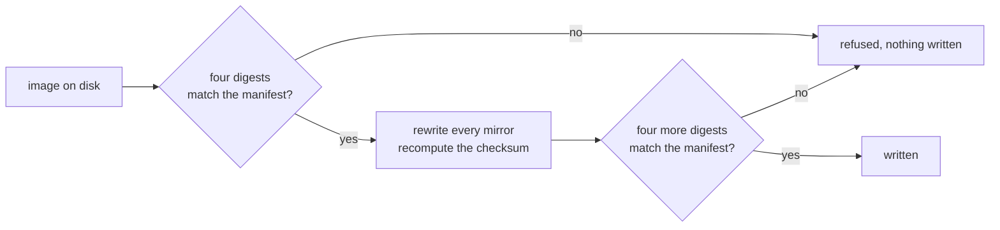

# Star Ocean, no chip: the header fix

A header correction for neviksti's two 96 Mbit Star Ocean rebuilds, held to four pinned digests of every file from the retail cartridge to the corrected image.

English | [日本語](README.ja.md) | [简体中文](README.zh-Hans.md) | [繁體中文（香港）](README.zh-HK.md)

[](https://github.com/gufranco/snes-star-ocean-nochip-fix/actions/workflows/ci.yml)
[](https://github.com/gufranco/snes-star-ocean-nochip-fix/releases)
[](LICENSE)

**2** editions, **12** bytes changed per image and none elsewhere, **32** pinned digests across the two chains, **0** disagreements, **616** tests, **100%** statement and branch coverage, no dependencies

```python
import tempfile
from pathlib import Path

from starocean import EDITIONS, look, report, verdict

with tempfile.TemporaryDirectory() as where:
    (Path(where) / "Star Ocean (Japan).sfc").write_bytes(b"a different file")
    found = look(where, EDITIONS, where)

for line in report(found)[:4]:
    print(line)
print(verdict(found))
```

```
  japanese: source altered, Star Ocean (Japan).sfc (found 455314660dc0a594)
  japanese: patch absent, 96Mbit_SO_JPN.xdelta
  japanese: reads absent, Star Ocean (J) SDD1 Patched (Hack) v1 Neviksti.sfc
  japanese: writes absent, star-ocean-jp-nochip.sfc
wrong
```

The example puts a file under the name of the Japanese retail cartridge with the wrong content, and asks what is there. `look` finds the file, digests it, and reports it as `altered` with the first 16 hex digits of the sha256 it found. The other three links of the Japanese chain are not there and read as `absent`. One altered link makes the verdict `wrong`. Nothing was written.

## Install

| Requirement | Version |
|:--|:--|
| Python | 3.12 or newer |
| git | Any, to fetch the submodule |

```bash
git clone --recurse-submodules https://github.com/gufranco/snes-star-ocean-nochip-fix.git
cd snes-star-ocean-nochip-fix
python3 starocean/doctor.py
```

The header reader is a submodule, `snes-rom-image-python`, and the memory map it uses is a submodule nested inside it, `snes-mapper-python`. A source archive from the download-zip link carries neither, so that checkout cannot correct anything. In a checkout made without `--recurse-submodules`, run `git submodule update --init --recursive`.

The doctor reports the machine, the submodule, the manifest and every link of both chains it finds under [`roms/`](roms/) and `dist/`, and ends with one line. Paste its whole output into any bug report. It exits 0 when every check passes and 1 when one does not.

```
  14 checks, nothing to report
```

The commands run as files from the checkout. This repository ships no packaging block, because it takes `snes-rom-image` as a submodule rather than as a version range, and a wheel built from here would fail on its first import.

Releases follow [Semantic Versioning](https://semver.org/) and are cut from the commit history by semantic-release. Every release is tagged and listed on the [releases page](https://github.com/gufranco/snes-star-ocean-nochip-fix/releases).

## The interface

### Commands

You supply the files. Put them in [`roms/`](roms/) under the names [`roms/README.md`](roms/README.md) lists, then:

```bash
python3 starocean/verify.py roms dist
python3 starocean/fix.py roms dist
```

| Command | Arguments | Does | Exit codes |
|:--|:--|:--|:--|
| `python3 starocean/verify.py` | `[source] [destination]`, default `roms` and `dist` | Looks for all four links of both chains, reports each, and writes nothing | 0 every file found matches, 1 a file found does not, 2 nothing from either chain is there |
| `python3 starocean/fix.py` | `[source] [destination]`, default the source directory below and `dist` | Confirms each rebuild, corrects it, confirms the result, and writes it | 0 at least one image written and none refused, 1 an image was refused, 2 neither rebuild is there |
| `python3 starocean/doctor.py` | none | Reports what is on this machine | 0 every check passes, 1 one does not |

When `fix.py` gets no source argument, it reads from the directory `STAR_OCEAN_ROM_DIR` names. A named directory is used even when it is empty, with no fallback, so a mistyped path finds no image rather than an image somewhere else. Without the variable it takes the first directory that exists out of `roms` beside this checkout and [`roms/`](roms/) inside it. `verify.py` takes its directory only as an argument.

```python
from starocean import fix, verify

print(fix.main(["nowhere", "nowhere"]))
print(verify.main(["nowhere", "nowhere"]))
```

```
  japanese: not here, Star Ocean (J) SDD1 Patched (Hack) v1 Neviksti.sfc is not in nowhere. A copy you already own goes there, or wherever the source directory points
  english: not here, Star Ocean (J) T+Eng, SDD1 Patched v1 DeJap, SDD1 v1 Neviksti.sfc is not in nowhere. A copy you already own goes there, or wherever the source directory points
  neither image was found in nowhere, so nothing was written
2
  japanese: source absent, Star Ocean (Japan).sfc
  japanese: patch absent, 96Mbit_SO_JPN.xdelta
  japanese: reads absent, Star Ocean (J) SDD1 Patched (Hack) v1 Neviksti.sfc
  japanese: writes absent, star-ocean-jp-nochip.sfc
  english: source absent, Star Ocean (J) T+Eng v1.0 DeJap.sfc
  english: patch absent, 96Mbit_SO_ENG.xdelta
  english: reads absent, Star Ocean (J) T+Eng, SDD1 Patched v1 DeJap, SDD1 v1 Neviksti.sfc
  english: writes absent, star-ocean-en-nochip.sfc
  nothing from the chain was found under nowhere
2
```

`main(argv)` is what each command runs, and it returns the exit code. With both rebuilds present, `fix.py` prints each edition, the path it wrote and the sha256 of what it wrote, then `2 of 2 corrected`.

### Reading and correcting

| Call | Does | Returns |
|:--|:--|:--|
| `look(source=None, catalogue=None, destination=None)` | Looks for every link of every chain: `source`, `patch` and `reads` under `source`, `writes` under `destination`. Subdirectories are walked. Defaults are `roms`, `EDITIONS` and `dist` | A list of `Finding` |
| `report(findings)` | One line per finding, with the first 16 hex digits of the sha256 found for an `altered` or `corrupt` file | A list of strings |
| `verdict(findings)` | `WRONG` when any finding is `altered` or `corrupt`, else `SOUND` when any `matches`, else `NOTHING` | A string |
| `confirm(image, edition)` | Checks the length, then the sha256, then the other three digests against `edition.before` | The `edition` |
| `correct(image)` | Declares no coprocessor and the size the image has, in every header mirror, and recomputes the checksum. Checks nothing | The corrected bytes |
| `apply(image, edition)` | `confirm`, `correct`, then the four digests of the result against `edition.after` | The corrected bytes |
| `run(edition, source, destination)` | Reads `edition.reads` from `source`, applies it, and writes `edition.writes` under `destination`, making the directory | The path written |
| `digests_of(data)` | crc32, md5, sha1 and sha256, as lowercase hex | A dict |
| `directories(environment=None)` | The places `fix.py` looks: each entry of `STAR_OCEAN_ROM_DIR` split on the path separator, then `roms` beside the checkout, then `roms` inside it | A tuple of paths |
| `source_directory(environment=None, places=None)` | `STAR_OCEAN_ROM_DIR` as given when it is set, else the first of `places` that is a directory, else `roms` inside the checkout | A path |

`look`, `report`, `verdict`, `confirm`, `correct`, `apply` and `digests_of` write nothing. `run` is the only call that writes.

| `Finding` attribute | Meaning |
|:--|:--|
| `edition` | The `Edition` the link belongs to |
| `step` | The `Step` it is |
| `path` | Where it was looked for or found |
| `state` | `ABSENT`, `MATCHES`, `ALTERED` when the sha256 differs, or `CORRUPT` when the sha256 matches and another digest does not |
| `found` | The four digests of the file, or `None` when it is absent |

```python
import os
from pathlib import Path

from starocean import directories, fix, source_directory

print(source_directory({"STAR_OCEAN_ROM_DIR": "/srv/roms"}))
print(source_directory({}, places=[Path("/nowhere")]) == fix.DEFAULT_SOURCE)
named = {"STAR_OCEAN_ROM_DIR": os.pathsep.join(["/a", "/b"])}
print([str(where) for where in directories(named)][:2])
print(directories({})[-1] == fix.DEFAULT_SOURCE)
```

```
/srv/roms
True
['/a', '/b']
True
```

### Editions and their chains

| Name | Content |
|:--|:--|
| `EDITIONS` | The two `Edition` records, `japanese` then `english`, loaded from [`editions.manifest.json`](editions.manifest.json) |
| `named(name, among=None)` | The edition with that name. Raises `UnknownEdition` for any other |
| `matching(digest, among=None)` | The edition whose input has that sha256, or `None` |
| `load(path=None)`, `load_patch(path=None)` | The editions, or the `Patch`, read from a manifest, by default the one in this checkout |
| `PATCH` | The `Patch` record: `name`, `version`, `author`, `where`, `note`, `archive` |
| `EXPECTED_BYTES` | `0xC00000`, 12,582,912 bytes, the length of every input and output |

| `Edition` attribute | Meaning |
|:--|:--|
| `name`, `summary` | The edition's name and one sentence about it |
| `reads`, `writes` | The file name the correction reads and the one it writes |
| `size` | The length both of those must have |
| `before`, `after` | The four digests of the input and of the output |
| `source`, `patch` | The manifest entries for the retail cartridge and for neviksti's patch |
| `chain()` | Four `Step` records, in order: `source`, `patch`, `reads`, `writes` |

A `Step` carries `what`, `name`, `held` and `produced`, which is true only for `writes`. `step.bytes` is its pinned length and `step.digest(which=None)` returns one pinned digest, the sha256 by default.

```python
from starocean import EDITIONS, EXPECTED_BYTES, PATCH, named

for edition in EDITIONS:
    print(edition.name, edition.size == EXPECTED_BYTES, edition.writes)
    for step in edition.chain():
        print(" ", step.what, step.bytes, step.digest()[:16], step.produced)

print(PATCH)
print(named("english").summary)
```

```
japanese True star-ocean-jp-nochip.sfc
  source 6291456 efae37be832d0ea1 False
  patch 3227030 8c3869301f396f44 False
  reads 12582912 e5ba9bef71c8ea31 False
  writes 12582912 4656c58a296b8901 True
english True star-ocean-en-nochip.sfc
  source 6291456 504050fcbcf1b676 False
  patch 2869793 83b209ef73241fa3 False
  reads 12582912 1bcb3b8b58f19a91 False
  writes 12582912 3f0af092ae356444 True
<Patch Star Ocean no S-DD1/96Mbit hack 1.0, by neviksti>
The same patch on the DeJap English translation. The two are not interchangeable.
```

### Digests

| Name | Content |
|:--|:--|
| `DIGESTS` | `('crc32', 'md5', 'sha1', 'sha256')`, every digest a file is checked against |
| `DECIDES` | `'sha256'`, the one that identifies a file. The other three are cross-checks |
| `DIGEST_WIDTHS` | The hex length of each: 8, 32, 40 and 64 |

```python
from starocean import DECIDES, DIGEST_WIDTHS, DIGESTS, digests_of, matching, named

found = digests_of(b"not a cartridge")
print(DIGESTS, DECIDES)
print({name: len(found[name]) == DIGEST_WIDTHS[name] for name in DIGESTS})
print(found["crc32"])

japanese = named("japanese")
print(matching(japanese.before[DECIDES]))
print(matching(found[DECIDES]))
```

```
('crc32', 'md5', 'sha1', 'sha256') sha256
{'crc32': True, 'md5': True, 'sha1': True, 'sha256': True}
11c17190
<Edition japanese, 12582912 bytes>
None
```

### Errors

All six live in [`starocean/errors.py`](starocean/errors.py), and each is published at the package root.

| Error | Raised by | When |
|:--|:--|:--|
| `Unrecognised` | `confirm`, `apply` | The file has the wrong length, or the right length and a different sha256 |
| `Corrupt` | `confirm`, `apply` | The sha256 matches and another of the four digests does not, so the manifest contradicts itself |
| `NotACartridge` | `correct`, `apply` | No cartridge header is found in the bytes |
| `Unexpected` | `apply` | The input was the one named and the corrected result has a sha256 other than the one pinned |
| `Missing` | `run` | The file the edition reads is not in the source directory |
| `UnknownEdition` | `named` | No edition has that name |

`fix.py` reports `Missing` as `not here` and goes on to the next edition. It reports the other four as `refused`, writes nothing for that edition, and exits 1.

```python
from starocean import (
    Corrupt,
    Edition,
    Missing,
    NotACartridge,
    UnknownEdition,
    Unrecognised,
    apply,
    confirm,
    correct,
    digests_of,
    named,
    run,
)

japanese = named("japanese")
data = b"not a cartridge"
held = digests_of(data)
pinned = Edition(
    name="sample",
    summary="",
    reads="in.sfc",
    writes="out.sfc",
    size=len(data),
    before=dict(held, md5="0" * 32),
    after=held,
    source={"name": "a"},
    patch={"name": "b"},
)

attempts = (
    lambda: confirm(data, japanese),
    lambda: correct(data),
    lambda: apply(data, pinned),
    lambda: named("french"),
    lambda: run(japanese, "nowhere", "nowhere"),
)
for attempt in attempts:
    try:
        attempt()
    except (Unrecognised, NotACartridge, Corrupt, UnknownEdition, Missing) as error:
        print(type(error).__name__ + ":", str(error).split(". ")[0])
```

```
Unrecognised: japanese is 12582912 bytes and this is 15
NotACartridge: nothing in these 15 bytes reads as a cartridge header, so there is no header to correct
Corrupt: sample matches on sha256 but not on md5: the manifest says 00000000000000000000000000000000 and the file gives 13c705c309736ec991ef4bc3abb3745d
UnknownEdition: french is not an edition this corrects; there are japanese, english
Missing: Star Ocean (J) SDD1 Patched (Hack) v1 Neviksti.sfc is not in nowhere
```

### Version and states

| Name | Content |
|:--|:--|
| `VERSION`, `__version__` | The release this checkout is, written by the release job |
| `ABSENT`, `MATCHES`, `ALTERED`, `CORRUPT` | The four states of a `Finding` |
| `NOTHING`, `SOUND`, `WRONG` | The three answers of `verdict` |

## Credit where it belongs

| Who | What |
|:--|:--|
| **neviksti** | Reverse-engineered the S-DD1 and wrote the [Star Ocean no S-DD1/96Mbit hack](https://www.romhacking.net/hacks/614/), which decompresses the graphics ahead of time and rebuilds the cartridge at 96 Mbit, so the chip is not needed. Two patches, one for the Japanese original and one for the translated build |
| **DeJap Translations** | The English translation the second patch is built on |

neviksti's stated purpose is real hardware: backup units such as the Game Doctor SF7, flash carts and custom boards have no S-DD1, so an unmodified Star Ocean does not run on them. Those are also the machines that read the header.

## What is wrong

Star Ocean shipped on an S-DD1 board, and the chip decompressed graphics on the way to the console. After neviksti's patch the data is already decompressed. Both rebuilds still declare an S-DD1 in their header.

| Field | Says | Should say |
|:--|:--|:--|
| Chipset | `0x45`, S-DD1 with save memory | `0x00`, no coprocessor |
| Declared size | `0x0D`, 8 megabytes | `0x0E`, 16 megabytes, the first power of two that holds 12 |
| Checksum and complement | Cover the old fields | Cover the new ones |

The size field holds a power of two, and 12 megabytes is not one, so the rebuilds inherited a declaration that never matched their length.

## The solution

[`snes-mapper`](https://github.com/gufranco/snes-mapper-python) decides where the header sits. [`snes-rom-image`](https://github.com/gufranco/snes-rom-image-python) rewrites every mirror and recomputes the checksum. This repository checks the image against the manifest before the rewrite and checks the result after it.



A file other than the one named is refused before the rewrite touches it. A rewrite that produces anything other than the pinned result is refused before it reaches the disk.

## The two editions

| Edition | Starts from | Patch | Writes |
|:--|:--|:--|:--|
| `japanese` | `Star Ocean (Japan).sfc` | `96Mbit_SO_JPN.xdelta` | `star-ocean-jp-nochip.sfc` |
| `english` | `Star Ocean (J) T+Eng v1.0 DeJap.sfc`, the same cartridge with DeJap's translation applied | `96Mbit_SO_ENG.xdelta` | `star-ocean-en-nochip.sfc` |

The two patches are not interchangeable. For the English chain, apply DeJap's translation first and the 96 Mbit patch second, as neviksti specifies.

## The whole chain is pinned, not just the ends

Every file between a cartridge you own and the image this writes carries its length and four digests: the retail image, the patch, the rebuild, and the corrected image. `verify.py` reports each link as `absent`, `matches`, `altered` or `corrupt`, so a wrong rebuild is traced to the link that went wrong, such as the wrong patch applied two steps earlier.


Every file name and digest is in [`editions.manifest.json`](editions.manifest.json) and is listed in [`roms/README.md`](roms/README.md). The patch archive is pinned there too, with its length and four digests.

## Why both ends are pinned

A rewritten header and a corrupted one are both files of exactly the right length. Four digests of the input and four of the output catch three cases:

- **A wrong input, before the rewrite.** A different revision of the patch produces a file of the right length with different content.
- **A changed correction, after it.** The input matched and the output does not, so the correction itself moved, and the run raises `Unexpected` instead of writing.
- **A manifest that contradicts itself, either way.** All four digests are compared, and a crc32, md5 or sha1 that disagrees with a matching sha256 raises `Corrupt`.

## What actually changes

Six bytes in each of the two header mirrors, at `0x7FC0` and `0xA07FC0`:

| Offset in the mirror | Field | Before | After |
|:--|:--|:--|:--|
| `0x16` | Chipset | `0x45` | `0x00` |
| `0x17` | Declared size | `0x0D` | `0x0E` |
| `0x1C`, `0x1D` | Checksum complement | Old | Recomputed |
| `0x1E`, `0x1F` | Checksum | Old | Recomputed |

A test asserts that every byte that moves lies inside a header mirror, and a second correction of a corrected image changes nothing.

The manifest also records, under `supersedes`, the digests this tool wrote before 2026-08-25. Those images carry a checksum computed by a rule that was wrong for a length that is not a power of two. An image matching them is one revision old: run the correction again on the rebuild.

```python
from starocean import named

japanese = named("japanese")

print(japanese.before["sha256"][:16])
print(japanese.after["sha256"][:16])
```

```
e5ba9bef71c8ea31
4656c58a296b8901
```

## Is it right

```bash
python3 conformance/against_images.test.py
```

With the rebuilds in [`roms/`](roms/), this checks every pinned digest of the input and of the output, that the result declares no coprocessor and carries a checksum that covers it, that the header still sits at `0x7FC0`, that only header mirrors move, and that correcting twice gives the same bytes. Without them, its 11 tests skip and say why. CI runs both commands on every push, and annotates the run when no image is present.

[`conformance/hardware.json`](conformance/hardware.json) holds the two facts this repository pins: the image length and the size byte that follows from it. Everything else about a header is pinned in `snes-rom-image-python`. [`conformance/divergences.json`](conformance/divergences.json) records that the size byte comes from Nintendo's rule rather than a printed row, and [OPEN-QUESTIONS.md](OPEN-QUESTIONS.md) lists the 3 things not settled.

## Working on it

| Need | Where |
|:--|:--|
| Every gate and the order to run them | [CONTRIBUTING.md](CONTRIBUTING.md) |
| The same material for a coding agent | [AGENTS.md](AGENTS.md) |
| The standard this repository shares with the rest of the family | [FAMILY.md](FAMILY.md) |
| Bug reports | [GitHub Issues](https://github.com/gufranco/snes-star-ocean-nochip-fix/issues) |
| Security reports | [SECURITY.md](SECURITY.md) |

```bash
uvx ruff@0.16.3 format --check .
uvx ruff@0.16.3 check .
uvx --python 3.12 mypy==1.14.1
python3 -m coverage erase
for file in $(find starocean conformance -name '*.test.py' | sort); do
  python3 -m coverage run -a "$file"
done
python3 -m coverage report
python3 -m conformance.speed
```

Each module has a test file beside it, named after it, and each runs on its own. Coverage is a hard gate at 100% statement and branch. The throughput floor, 50 digest passes over a megabyte per second, runs outside the coverage step.

A weekly job reports when the pinned submodule falls behind its upstream. Moving the pin is a deliberate change, because a header reader that changes what it writes changes every pinned output digest.

## References

| Package | Does |
|:--|:--|
| [`snes-rom-image`](https://github.com/gufranco/snes-rom-image-python) | Finds every header mirror, rewrites the fields, recomputes the checksum |
| [`snes-mapper`](https://github.com/gufranco/snes-mapper-python) | Decides where a header is, out of the places one can be |

- [Star Ocean no S-DD1/96Mbit hack](https://www.romhacking.net/hacks/614/), neviksti, on Romhacking.net
- [S-DD1](https://wiki.superfamicom.org/s-dd1), Super Famicom Development Wiki
- [SNES: Star Ocean English translation/hack](https://github.com/frederic-mahe/Hardware-Target-Game-Database/issues/622), Hardware Target Game Database
- *SNES Development Manual, Book I*, Nintendo of America Inc. 21,022,582 bytes, SHA-256 `f1405241000046abba7849376d2ec53cf85f1ad2e9950d69a7c2cf1f3ff6b791`. It is not redistributable and is not in this repository. [`conformance/documents.json`](conformance/documents.json) carries its identity, and `python3 -m conformance.documents` downloads it from https://archive.org/download/SNESDevManual/book1_text.pdf into `docs/`, which git ignores, and refuses any other file. `python3 -m conformance.documents --check` verifies a copy already there.

## Citing this

[CITATION.cff](CITATION.cff) is updated with each release by the script that stamps the package version.

## License

MIT, covering the code in this repository and nothing else.

Neither image is distributed here and neither can be reconstructed from anything in this repository. Star Ocean belongs to its publisher, the S-DD1 removal is neviksti's work, and the English translation is DeJap's. See [`roms/README.md`](roms/README.md).
