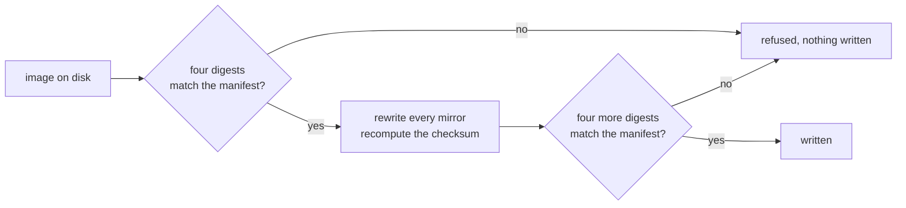

[English](README.md) | [日本語](README.ja.md) | [简体中文](README.zh-Hans.md) | 繁體中文（香港）

# 無晶片版 Star Ocean：檔頭修正

為 neviksti 的兩個 96 Mbit Star Ocean 重建版提供的檔頭修正。從零售版卡帶到修正後的映像檔，每個檔案都以四個固定的摘要值核對。

[](https://github.com/gufranco/snes-star-ocean-nochip-fix/actions/workflows/ci.yml)
[](https://github.com/gufranco/snes-star-ocean-nochip-fix/releases)
[](LICENSE)

**2** 個版本，每個映像檔更改 **12** 個位元組，其他地方不變，兩條鏈共 **32** 個固定摘要值，**0** 處不一致，**575** 項測試，**100%** 語句及分支覆蓋率，沒有依賴項

```python
import tempfile
from pathlib import Path

from starocean import EDITIONS, look, report, verdict

with tempfile.TemporaryDirectory() as where:
    (Path(where) / "Star Ocean (Japan).sfc").write_bytes(b"a different file")
    found = look(where, EDITIONS, where)

for line in report(found)[:4]:
    print(line)
print(verdict(found))
```

```
  japanese: source altered, Star Ocean (Japan).sfc (found 455314660dc0a594)
  japanese: patch absent, 96Mbit_SO_JPN.xdelta
  japanese: reads absent, Star Ocean (J) SDD1 Patched (Hack) v1 Neviksti.sfc
  japanese: writes absent, star-ocean-jp-nochip.sfc
wrong
```

這個示例以日本零售版卡帶的名稱放置一個內容錯誤的檔案，然後查詢那裏有甚麼。`look` 找到該檔案，計算其摘要值，並報告為 `altered`，附上它找到的 sha256 的首 16 個十六進位數字。日文鏈的其餘三個環節不存在，讀作 `absent`。一個環節被改動，結論便是 `wrong`。過程中沒有寫入任何東西。

## 安裝

| 要求 | 版本 |
|:--|:--|
| Python | 3.12 或更新 |
| git | 任何版本，用於取得子模組 |

```bash
git clone --recurse-submodules https://github.com/gufranco/snes-star-ocean-nochip-fix.git
cd snes-star-ocean-nochip-fix
python3 starocean/doctor.py
```

檔頭讀取器是一個子模組 `snes-rom-image-python`，它使用的記憶體映射是嵌套在其中的另一個子模組 `snes-mapper-python`。從下載 zip 連結取得的原始碼封存檔兩者都不包含，因此那樣的副本無法修正任何東西。如果副本是在沒有 `--recurse-submodules` 的情況下取得，請執行 `git submodule update --init --recursive`。

診斷腳本會報告本機、子模組、清單，以及它在 [`roms/`](roms/) 和 `dist/` 下找到的兩條鏈的每個環節，最後輸出一行結果。提交錯誤報告時，請貼上它的完整輸出。所有檢查通過時以 0 結束，有任何一項不通過時以 1 結束。

```
  14 checks, nothing to report
```

這些命令以檔案形式從副本中執行。本儲存庫不提供打包設定，因為它以子模組而非版本範圍引入 `snes-rom-image`，從這裏建置的 wheel 會在第一次 import 時失敗。

版本發佈遵循 [Semantic Versioning](https://semver.org/)，由 semantic-release 根據提交歷史產生。每個版本都會加上標籤，並列在[發佈頁面](https://github.com/gufranco/snes-star-ocean-nochip-fix/releases)上。

## 介面

### 命令

檔案由你提供。按照 [`roms/README.md`](roms/README.md) 列出的名稱放入 [`roms/`](roms/)，然後執行：

```bash
python3 starocean/verify.py roms dist
python3 starocean/fix.py roms dist
```

| 命令 | 參數 | 作用 | 結束碼 |
|:--|:--|:--|:--|
| `python3 starocean/verify.py` | `[source] [destination]`，預設為 `roms` 和 `dist` | 尋找兩條鏈的全部四個環節，逐一報告，不寫入任何東西 | 0 找到的每個檔案都相符，1 找到的某個檔案不相符，2 兩條鏈的檔案都不存在 |
| `python3 starocean/fix.py` | `[source] [destination]`，預設為下述的來源目錄和 `dist` | 確認每個重建版，修正它，確認結果，然後寫入 | 0 至少寫入一個映像檔且沒有拒絕任何映像檔，1 有映像檔被拒絕，2 兩個重建版都不存在 |
| `python3 starocean/doctor.py` | 無 | 報告本機上有甚麼 | 0 所有檢查通過，1 有一項不通過 |

`fix.py` 沒有收到來源參數時，會從 `STAR_OCEAN_ROM_DIR` 指定的目錄讀取。即使指定的目錄是空的，也照樣使用，不會改用其他目錄，因此路徑打錯時會找不到任何映像檔，而不是找到別處的映像檔。沒有設定該變數時，它會在本副本旁邊的 `roms` 和副本內的 [`roms/`](roms/) 之中，取第一個存在的目錄。`verify.py` 只從參數取得目錄。

```python
from starocean import fix, verify

print(fix.main(["nowhere", "nowhere"]))
print(verify.main(["nowhere", "nowhere"]))
```

```
  japanese: not here, Star Ocean (J) SDD1 Patched (Hack) v1 Neviksti.sfc is not in nowhere. A copy you already own goes there, or wherever the source directory points
  english: not here, Star Ocean (J) T+Eng, SDD1 Patched v1 DeJap, SDD1 v1 Neviksti.sfc is not in nowhere. A copy you already own goes there, or wherever the source directory points
  neither image was found in nowhere, so nothing was written
2
  japanese: source absent, Star Ocean (Japan).sfc
  japanese: patch absent, 96Mbit_SO_JPN.xdelta
  japanese: reads absent, Star Ocean (J) SDD1 Patched (Hack) v1 Neviksti.sfc
  japanese: writes absent, star-ocean-jp-nochip.sfc
  english: source absent, Star Ocean (J) T+Eng v1.0 DeJap.sfc
  english: patch absent, 96Mbit_SO_ENG.xdelta
  english: reads absent, Star Ocean (J) T+Eng, SDD1 Patched v1 DeJap, SDD1 v1 Neviksti.sfc
  english: writes absent, star-ocean-en-nochip.sfc
  nothing from the chain was found under nowhere
2
```

`main(argv)` 是每個命令執行的函數，它會傳回結束碼。兩個重建版都存在時，`fix.py` 會輸出每個版本、它寫入的路徑和所寫內容的 sha256，最後輸出 `2 of 2 corrected`。

### 讀取與修正

| 呼叫 | 作用 | 傳回 |
|:--|:--|:--|
| `look(source=None, catalogue=None, destination=None)` | 尋找每條鏈的每個環節：在 `source` 下尋找 `source`、`patch` 和 `reads`，在 `destination` 下尋找 `writes`。會遍歷子目錄。預設值為 `roms`、`EDITIONS` 和 `dist` | 一個 `Finding` 清單 |
| `report(findings)` | 每項結果一行，`altered` 或 `corrupt` 的檔案會附上找到的 sha256 的首 16 個十六進位數字 | 一個字串清單 |
| `verdict(findings)` | 有任何結果為 `altered` 或 `corrupt` 時為 `WRONG`，否則有任何結果為 `matches` 時為 `SOUND`，否則為 `NOTHING` | 一個字串 |
| `confirm(image, edition)` | 先檢查長度，再檢查 sha256，然後以 `edition.before` 核對其餘三個摘要值 | 該 `edition` |
| `correct(image)` | 在每個檔頭鏡像中宣告沒有協處理器及映像檔的實際大小，並重新計算校驗和。不作任何檢查 | 修正後的位元組 |
| `apply(image, edition)` | 執行 `confirm`、`correct`，然後以 `edition.after` 核對結果的四個摘要值 | 修正後的位元組 |
| `run(edition, source, destination)` | 從 `source` 讀取 `edition.reads`，套用修正，並在 `destination` 下寫入 `edition.writes`，有需要時建立該目錄 | 寫入的路徑 |
| `digests_of(data)` | crc32、md5、sha1 和 sha256，以小寫十六進位表示 | 一個 dict |
| `directories(environment=None)` | `fix.py` 尋找的位置：`STAR_OCEAN_ROM_DIR` 按路徑分隔符拆分後的每一項，然後是副本旁邊的 `roms`，然後是副本內的 `roms` | 一個路徑 tuple |
| `source_directory(environment=None, places=None)` | 已設定 `STAR_OCEAN_ROM_DIR` 時按原樣使用它，否則取 `places` 中第一個是目錄的項目，否則取副本內的 `roms` | 一個路徑 |

`look`、`report`、`verdict`、`confirm`、`correct`、`apply` 和 `digests_of` 不寫入任何東西。`run` 是唯一會寫入的呼叫。

| `Finding` 屬性 | 意思 |
|:--|:--|
| `edition` | 該環節所屬的 `Edition` |
| `step` | 它是哪一個 `Step` |
| `path` | 尋找或找到它的位置 |
| `state` | `ABSENT`、`MATCHES`、sha256 不同時為 `ALTERED`，sha256 相符但另一個摘要值不相符時為 `CORRUPT` |
| `found` | 該檔案的四個摘要值，檔案不存在時為 `None` |

```python
import os
from pathlib import Path

from starocean import directories, fix, source_directory

print(source_directory({"STAR_OCEAN_ROM_DIR": "/srv/roms"}))
print(source_directory({}, places=[Path("/nowhere")]) == fix.DEFAULT_SOURCE)
named = {"STAR_OCEAN_ROM_DIR": os.pathsep.join(["/a", "/b"])}
print([str(where) for where in directories(named)][:2])
print(directories({})[-1] == fix.DEFAULT_SOURCE)
```

```
/srv/roms
True
['/a', '/b']
True
```

### 版本及其鏈

| 名稱 | 內容 |
|:--|:--|
| `EDITIONS` | 兩個 `Edition` 記錄，先 `japanese` 後 `english`，從 [`editions.manifest.json`](editions.manifest.json) 載入 |
| `named(name, among=None)` | 該名稱的版本。名稱不符時引發 `UnknownEdition` |
| `matching(digest, among=None)` | 輸入的 sha256 為該值的版本，或 `None` |
| `load(path=None)`、`load_patch(path=None)` | 從清單讀取的版本或 `Patch`，預設使用本副本中的清單 |
| `PATCH` | `Patch` 記錄：`name`、`version`、`author`、`where`、`note`、`archive` |
| `EXPECTED_BYTES` | `0xC00000`，即 12,582,912 位元組，每個輸入和輸出的長度 |

| `Edition` 屬性 | 意思 |
|:--|:--|
| `name`、`summary` | 版本名稱，以及一句關於它的說明 |
| `reads`、`writes` | 修正讀取的檔案名稱和寫入的檔案名稱 |
| `size` | 這兩個檔案必須具有的長度 |
| `before`、`after` | 輸入和輸出各自的四個摘要值 |
| `source`、`patch` | 零售版卡帶和 neviksti 修補檔的清單項目 |
| `chain()` | 按順序排列的四個 `Step` 記錄：`source`、`patch`、`reads`、`writes` |

`Step` 帶有 `what`、`name`、`held` 和 `produced`，其中 `produced` 只在 `writes` 時為真。`step.bytes` 是它的固定長度，`step.digest(which=None)` 傳回一個固定摘要值，預設為 sha256。

```python
from starocean import EDITIONS, EXPECTED_BYTES, PATCH, named

for edition in EDITIONS:
    print(edition.name, edition.size == EXPECTED_BYTES, edition.writes)
    for step in edition.chain():
        print(" ", step.what, step.bytes, step.digest()[:16], step.produced)

print(PATCH)
print(named("english").summary)
```

```
japanese True star-ocean-jp-nochip.sfc
  source 6291456 efae37be832d0ea1 False
  patch 3227030 8c3869301f396f44 False
  reads 12582912 e5ba9bef71c8ea31 False
  writes 12582912 4656c58a296b8901 True
english True star-ocean-en-nochip.sfc
  source 6291456 504050fcbcf1b676 False
  patch 2869793 83b209ef73241fa3 False
  reads 12582912 1bcb3b8b58f19a91 False
  writes 12582912 3f0af092ae356444 True
<Patch Star Ocean no S-DD1/96Mbit hack 1.0, by neviksti>
The same patch on the DeJap English translation. The two are not interchangeable.
```

### 摘要值

| 名稱 | 內容 |
|:--|:--|
| `DIGESTS` | `('crc32', 'md5', 'sha1', 'sha256')`，檔案要核對的全部摘要值 |
| `DECIDES` | `'sha256'`，用來識別檔案的摘要值。其餘三個用作交叉核對 |
| `DIGEST_WIDTHS` | 各自的十六進位長度：8、32、40 和 64 |

```python
from starocean import DECIDES, DIGEST_WIDTHS, DIGESTS, digests_of, matching, named

found = digests_of(b"not a cartridge")
print(DIGESTS, DECIDES)
print({name: len(found[name]) == DIGEST_WIDTHS[name] for name in DIGESTS})
print(found["crc32"])

japanese = named("japanese")
print(matching(japanese.before[DECIDES]))
print(matching(found[DECIDES]))
```

```
('crc32', 'md5', 'sha1', 'sha256') sha256
{'crc32': True, 'md5': True, 'sha1': True, 'sha256': True}
11c17190
<Edition japanese, 12582912 bytes>
None
```

### 錯誤

六種錯誤全部定義在 [`starocean/errors.py`](starocean/errors.py)，並且都在套件根層級公開。

| 錯誤 | 引發者 | 時機 |
|:--|:--|:--|
| `Unrecognised` | `confirm`、`apply` | 檔案長度錯誤，或長度正確但 sha256 不同 |
| `Corrupt` | `confirm`、`apply` | sha256 相符，但四個摘要值中另有一個不相符，即清單自相矛盾 |
| `NotACartridge` | `correct`、`apply` | 在位元組中找不到卡帶檔頭 |
| `Unexpected` | `apply` | 輸入是指定的那個檔案，但修正結果的 sha256 與固定值不同 |
| `Missing` | `run` | 版本要讀取的檔案不在來源目錄中 |
| `UnknownEdition` | `named` | 沒有該名稱的版本 |

`fix.py` 將 `Missing` 報告為 `not here`，然後繼續處理下一個版本。其餘四種則報告為 `refused`，不為該版本寫入任何東西，並以 1 結束。

```python
from starocean import (
    Corrupt,
    Edition,
    Missing,
    NotACartridge,
    UnknownEdition,
    Unrecognised,
    apply,
    confirm,
    correct,
    digests_of,
    named,
    run,
)

japanese = named("japanese")
data = b"not a cartridge"
held = digests_of(data)
pinned = Edition(
    name="sample",
    summary="",
    reads="in.sfc",
    writes="out.sfc",
    size=len(data),
    before=dict(held, md5="0" * 32),
    after=held,
    source={"name": "a"},
    patch={"name": "b"},
)

attempts = (
    lambda: confirm(data, japanese),
    lambda: correct(data),
    lambda: apply(data, pinned),
    lambda: named("french"),
    lambda: run(japanese, "nowhere", "nowhere"),
)
for attempt in attempts:
    try:
        attempt()
    except (Unrecognised, NotACartridge, Corrupt, UnknownEdition, Missing) as error:
        print(type(error).__name__ + ":", str(error).split(". ")[0])
```

```
Unrecognised: japanese is 12582912 bytes and this is 15
NotACartridge: nothing in these 15 bytes reads as a cartridge header, so there is no header to correct
Corrupt: sample matches on sha256 but not on md5: the manifest says 00000000000000000000000000000000 and the file gives 13c705c309736ec991ef4bc3abb3745d
UnknownEdition: french is not an edition this corrects; there are japanese, english
Missing: Star Ocean (J) SDD1 Patched (Hack) v1 Neviksti.sfc is not in nowhere
```

### 版本號與狀態

| 名稱 | 內容 |
|:--|:--|
| `VERSION`、`__version__` | 本副本所屬的版本，由發佈工作寫入 |
| `ABSENT`、`MATCHES`、`ALTERED`、`CORRUPT` | `Finding` 的四種狀態 |
| `NOTHING`、`SOUND`、`WRONG` | `verdict` 的三種答案 |

## 鳴謝

| 誰 | 貢獻 |
|:--|:--|
| **neviksti** | 逆向工程 S-DD1，並編寫了 [Star Ocean no S-DD1/96Mbit hack](https://www.romhacking.net/hacks/614/)。它預先解壓圖像，並以 96 Mbit 重建卡帶，因此不再需要該晶片。共有兩個修補檔，一個用於日文原版，一個用於翻譯版 |
| **DeJap Translations** | 第二個修補檔所基於的英文翻譯 |

neviksti 明言的目的是真實硬件：Game Doctor SF7 等備份裝置、燒錄卡帶和自製電路板都沒有 S-DD1，所以未經修改的 Star Ocean 無法在上面運行。這些機器同時也是會讀取檔頭的機器。

## 問題所在

Star Ocean 以 S-DD1 電路板發行，該晶片在圖像傳送到主機的途中將其解壓。套用 neviksti 的修補檔後，數據已經是解壓後的狀態。但兩個重建版的檔頭仍然宣告有 S-DD1。

| 欄位 | 現時的值 | 應有的值 |
|:--|:--|:--|
| 晶片組 | `0x45`，帶存檔記憶體的 S-DD1 | `0x00`，沒有協處理器 |
| 宣告大小 | `0x0D`，8 MB | `0x0E`，16 MB，即能容納 12 MB 的最小二的冪 |
| 校驗和及其補數 | 涵蓋舊欄位 | 涵蓋新欄位 |

大小欄位存放的是二的冪，而 12 MB 不是二的冪，因此重建版繼承了一個從來沒有與其長度相符的宣告。

## 解決方法

[`snes-mapper`](https://github.com/gufranco/snes-mapper-python) 決定檔頭所在的位置。[`snes-rom-image`](https://github.com/gufranco/snes-rom-image-python) 重寫每個鏡像並重新計算校驗和。本儲存庫在重寫前以清單核對映像檔，並在重寫後核對結果。



不是指定檔案的檔案，會在重寫觸及它之前被拒絕。重寫產生的結果只要不是固定的結果，就會在寫入磁碟之前被拒絕。

## 兩個版本

| 版本 | 起點 | 修補檔 | 寫入 |
|:--|:--|:--|:--|
| `japanese` | `Star Ocean (Japan).sfc` | `96Mbit_SO_JPN.xdelta` | `star-ocean-jp-nochip.sfc` |
| `english` | `Star Ocean (J) T+Eng v1.0 DeJap.sfc`，即套用了 DeJap 翻譯的同一卡帶 | `96Mbit_SO_ENG.xdelta` | `star-ocean-en-nochip.sfc` |

兩個修補檔不能互換。英文鏈須按 neviksti 的指示，先套用 DeJap 的翻譯，再套用 96 Mbit 修補檔。

## 整條鏈都已固定，不只兩端

從你擁有的卡帶到本工具寫出的映像檔，中間的每個檔案都帶有其長度和四個摘要值：零售版映像檔、修補檔、重建版和修正後的映像檔。`verify.py` 將每個環節報告為 `absent`、`matches`、`altered` 或 `corrupt`，因此錯誤的重建版可以追溯到出錯的環節，例如兩步之前套用了錯誤的修補檔。


每個檔案名稱和摘要值都在 [`editions.manifest.json`](editions.manifest.json) 中，並列於 [`roms/README.md`](roms/README.md)。修補檔的封存檔也在那裏固定，連同其長度和四個摘要值。

## 為何兩端都要固定

重寫過的檔頭和損壞的檔頭，兩者都是長度完全正確的檔案。輸入的四個摘要值和輸出的四個摘要值可以捕捉三種情況：

- **重寫前，輸入錯誤。** 不同修訂版本的修補檔會產生長度正確但內容不同的檔案。
- **重寫後，修正有變。** 輸入相符而輸出不相符，表示修正本身有所改動，此時執行會引發 `Unexpected` 而不寫入。
- **無論哪一端，清單自相矛盾。** 四個摘要值全部比對，若 sha256 相符而 crc32、md5 或 sha1 不一致，便會引發 `Corrupt`。

## 實際改動的內容

兩個檔頭鏡像各改動六個位元組，鏡像位於 `0x7FC0` 和 `0xA07FC0`：

| 鏡像內的偏移 | 欄位 | 修改前 | 修改後 |
|:--|:--|:--|:--|
| `0x16` | 晶片組 | `0x45` | `0x00` |
| `0x17` | 宣告大小 | `0x0D` | `0x0E` |
| `0x1C`、`0x1D` | 校驗和補數 | 舊值 | 重新計算 |
| `0x1E`、`0x1F` | 校驗和 | 舊值 | 重新計算 |

有一項測試斷言每個改動的位元組都位於檔頭鏡像之內，並且對已修正的映像檔再修正一次不會改變任何東西。

清單亦在 `supersedes` 下記錄了本工具在 2026-08-25 之前寫出的映像檔的摘要值。那些映像檔帶有的校驗和，是以一條對非二的冪長度並不正確的規則計算的。與這些摘要值相符的映像檔落後一個修訂版本：請對重建版重新執行修正。

```python
from starocean import named

japanese = named("japanese")

print(japanese.before["sha256"][:16])
print(japanese.after["sha256"][:16])
```

```
e5ba9bef71c8ea31
4656c58a296b8901
```

## 結果是否正確

```bash
python3 conformance/against_images.test.py
```

當重建版放在 [`roms/`](roms/) 中時，這會檢查輸入和輸出的每個固定摘要值，檢查結果宣告沒有協處理器且帶有涵蓋這項宣告的校驗和，檢查檔頭仍然位於 `0x7FC0`，檢查只有檔頭鏡像有改動，並檢查修正兩次得出相同的位元組。沒有重建版時，它的 11 項測試會略過並說明原因。CI 在每次推送時都會執行這兩個命令，沒有映像檔時會在該次執行上加註。

[`conformance/hardware.json`](conformance/hardware.json) 存放本儲存庫固定的兩項事實：映像檔長度，以及由此得出的大小位元組。檔頭的其他所有內容都在 `snes-rom-image-python` 中固定。[`conformance/divergences.json`](conformance/divergences.json) 記錄了大小位元組來自 Nintendo 的規則，而非印刷表格中的某一行；[OPEN-QUESTIONS.md](OPEN-QUESTIONS.md) 列出了 3 個尚未解決的問題。

## 參與開發

| 需要 | 位置 |
|:--|:--|
| 所有關卡檢查及其執行次序 | [CONTRIBUTING.md](CONTRIBUTING.md) |
| 供編程代理使用的相同資料 | [AGENTS.md](AGENTS.md) |
| 本儲存庫與同系列其他儲存庫共用的標準 | [FAMILY.md](FAMILY.md) |
| 錯誤報告 | [GitHub Issues](https://github.com/gufranco/snes-star-ocean-nochip-fix/issues) |
| 安全報告 | [SECURITY.md](SECURITY.md) |

```bash
uvx ruff@0.16.3 format --check .
uvx ruff@0.16.3 check .
uvx --python 3.12 mypy==1.14.1
python3 -m coverage erase
for file in $(find starocean conformance -name '*.test.py' | sort); do
  python3 -m coverage run -a "$file"
done
python3 -m coverage report
python3 -m conformance.speed
```

每個模組旁邊都有一個以其命名的測試檔案，每個測試檔案都可以獨立執行。覆蓋率是硬性關卡檢查，要求 100% 語句及分支覆蓋率。吞吐量下限為每秒對 1 MB 數據計算 50 次摘要值，在覆蓋率步驟之外執行。

每週有一項工作會在固定的子模組落後於上游時發出報告。移動固定版本是一項刻意的改動，因為檔頭讀取器若改變了寫出的內容，便會改變每個固定的輸出摘要值。

## 參考資料

| 套件 | 作用 |
|:--|:--|
| [`snes-rom-image`](https://github.com/gufranco/snes-rom-image-python) | 找出每個檔頭鏡像，重寫欄位，重新計算校驗和 |
| [`snes-mapper`](https://github.com/gufranco/snes-mapper-python) | 在檔頭可能所在的位置之中，決定它在哪裏 |

- [Star Ocean no S-DD1/96Mbit hack](https://www.romhacking.net/hacks/614/)，neviksti，刊於 Romhacking.net
- [S-DD1](https://wiki.superfamicom.org/s-dd1)，Super Famicom Development Wiki
- [SNES: Star Ocean English translation/hack](https://github.com/frederic-mahe/Hardware-Target-Game-Database/issues/622)，Hardware Target Game Database
- *SNES Development Manual, Book I*，Nintendo of America Inc.，21,022,582 位元組，SHA-256 `f1405241000046abba7849376d2ec53cf85f1ad2e9950d69a7c2cf1f3ff6b791`。此手冊不可再分發，亦不在本儲存庫中。[`conformance/documents.json`](conformance/documents.json) 記載其身份，`python3 -m conformance.documents` 會從 https://archive.org/download/SNESDevManual/book1_text.pdf 將它下載到 git 忽略的 `docs/`，並拒絕任何其他檔案。`python3 -m conformance.documents --check` 會核對已存在的副本。

## 引用本專案

[CITATION.cff](CITATION.cff) 會在每次發佈時，由寫入套件版本號的腳本更新。

## 授權

MIT，涵蓋本儲存庫中的程式碼，不涵蓋其他任何東西。

本儲存庫不分發任何一個映像檔，亦無法從本儲存庫的任何內容重建任何一個映像檔。Star Ocean 屬於其發行商，移除 S-DD1 是 neviksti 的成果，英文翻譯則是 DeJap 的成果。參見 [`roms/README.md`](roms/README.md)。
