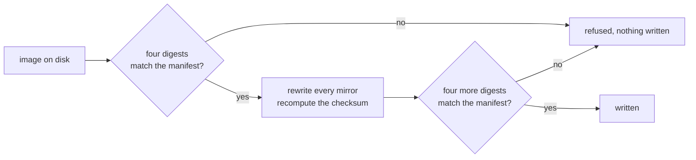

# Star Ocean 免芯片版：文件头修正

针对 neviksti 的两个 96 Mbit Star Ocean 重建版的文件头修正。从零售版卡带到修正后的镜像，每个文件都以四个固定摘要加以约束。

[English](README.md) | [日本語](README.ja.md) | 简体中文 | [繁體中文（香港）](README.zh-HK.md)

[](https://github.com/gufranco/snes-star-ocean-nochip-fix/actions/workflows/ci.yml)
[](https://github.com/gufranco/snes-star-ocean-nochip-fix/releases)
[](LICENSE)

**2** 个版本，每个镜像改动 **12** 个字节且别处不变，两条链共 **32** 个固定摘要，**0** 处不一致，**593** 个测试，**100%** 语句与分支覆盖率，无依赖

```python
import tempfile
from pathlib import Path

from starocean import EDITIONS, look, report, verdict

with tempfile.TemporaryDirectory() as where:
    (Path(where) / "Star Ocean (Japan).sfc").write_bytes(b"a different file")
    found = look(where, EDITIONS, where)

for line in report(found)[:4]:
    print(line)
print(verdict(found))
```

```
  japanese: source altered, Star Ocean (Japan).sfc (found 455314660dc0a594)
  japanese: patch absent, 96Mbit_SO_JPN.xdelta
  japanese: reads absent, Star Ocean (J) SDD1 Patched (Hack) v1 Neviksti.sfc
  japanese: writes absent, star-ocean-jp-nochip.sfc
wrong
```

这个示例以日版零售卡带的文件名放入一个内容错误的文件，然后询问其中有什么。`look` 找到该文件，计算其摘要，并将其报告为 `altered`，附上所得 sha256 的前 16 个十六进制位。日版链的其余三个环节不存在，读作 `absent`。只要有一个环节被改动，结论就是 `wrong`。没有写入任何内容。

## 安装

| 要求 | 版本 |
|:--|:--|
| Python | 3.12 或更高 |
| git | 任意版本，用于获取子模块 |

```bash
git clone --recurse-submodules https://github.com/gufranco/snes-star-ocean-nochip-fix.git
cd snes-star-ocean-nochip-fix
python3 starocean/doctor.py
```

文件头读取器是子模块 `snes-rom-image-python`，它使用的内存映射是嵌套在其中的子模块 `snes-mapper-python`。通过 download-zip 链接下载的源码归档不包含这两者，因此这样的检出无法修正任何内容。如果检出时没有使用 `--recurse-submodules`，请运行 `git submodule update --init --recursive`。

诊断脚本会报告本机、子模块、清单，以及它在 [`roms/`](roms/) 和 `dist/` 下找到的两条链的每个环节，最后输出一行结论。提交错误报告时请粘贴其完整输出。所有检查都通过时退出码为 0，有一项未通过时为 1。

```
  14 checks, nothing to report
```

这些命令以文件形式从检出目录运行。本仓库不提供打包配置块，因为它以子模块而非版本范围的方式引入 `snes-rom-image`，从这里构建的 wheel 会在第一次导入时失败。

版本遵循 [Semantic Versioning](https://semver.org/)，由 semantic-release 根据提交历史发布。每个版本都打上标签并列在[发布页面](https://github.com/gufranco/snes-star-ocean-nochip-fix/releases)上。

## 接口

### 命令

文件由你自己提供。按 [`roms/README.md`](roms/README.md) 列出的文件名把它们放进 [`roms/`](roms/)，然后运行：

```bash
python3 starocean/verify.py roms dist
python3 starocean/fix.py roms dist
```

| 命令 | 参数 | 作用 | 退出码 |
|:--|:--|:--|:--|
| `python3 starocean/verify.py` | `[source] [destination]`，默认为 `roms` 和 `dist` | 查找两条链的全部四个环节，逐一报告，不写入任何内容 | 0 找到的每个文件都匹配，1 找到的某个文件不匹配，2 两条链的文件都不存在 |
| `python3 starocean/fix.py` | `[source] [destination]`，默认为下文所述的源目录和 `dist` | 确认每个重建版，加以修正，确认结果，然后写入 | 0 至少写入一个镜像且没有被拒绝的，1 有镜像被拒绝，2 两个重建版都不存在 |
| `python3 starocean/doctor.py` | 无 | 报告本机上的情况 | 0 所有检查都通过，1 有一项未通过 |

`fix.py` 没有收到源参数时，会从 `STAR_OCEAN_ROM_DIR` 指定的目录读取。指定的目录即使为空也照样使用，不会改用其他目录，因此路径输错时找不到任何镜像，而不是找到别处的镜像。没有该变量时，它在本检出目录旁的 `roms` 和其中的 [`roms/`](roms/) 之间取第一个存在的目录。`verify.py` 只通过参数获取目录。

```python
from starocean import fix, verify

print(fix.main(["nowhere", "nowhere"]))
print(verify.main(["nowhere", "nowhere"]))
```

```
  japanese: not here, Star Ocean (J) SDD1 Patched (Hack) v1 Neviksti.sfc is not in nowhere. A copy you already own goes there, or wherever the source directory points
  english: not here, Star Ocean (J) T+Eng, SDD1 Patched v1 DeJap, SDD1 v1 Neviksti.sfc is not in nowhere. A copy you already own goes there, or wherever the source directory points
  neither image was found in nowhere, so nothing was written
2
  japanese: source absent, Star Ocean (Japan).sfc
  japanese: patch absent, 96Mbit_SO_JPN.xdelta
  japanese: reads absent, Star Ocean (J) SDD1 Patched (Hack) v1 Neviksti.sfc
  japanese: writes absent, star-ocean-jp-nochip.sfc
  english: source absent, Star Ocean (J) T+Eng v1.0 DeJap.sfc
  english: patch absent, 96Mbit_SO_ENG.xdelta
  english: reads absent, Star Ocean (J) T+Eng, SDD1 Patched v1 DeJap, SDD1 v1 Neviksti.sfc
  english: writes absent, star-ocean-en-nochip.sfc
  nothing from the chain was found under nowhere
2
```

`main(argv)` 是每个命令实际运行的函数，它返回退出码。两个重建版都存在时，`fix.py` 会输出每个版本、写入的路径和所写内容的 sha256，最后输出 `2 of 2 corrected`。

### 读取与修正

| 调用 | 作用 | 返回 |
|:--|:--|:--|
| `look(source=None, catalogue=None, destination=None)` | 查找每条链的每个环节：在 `source` 下查找 `source`、`patch` 和 `reads`，在 `destination` 下查找 `writes`。会遍历子目录。默认值为 `roms`、`EDITIONS` 和 `dist` | 一个 `Finding` 列表 |
| `report(findings)` | 每个发现输出一行，对 `altered` 或 `corrupt` 的文件附上所得 sha256 的前 16 个十六进制位 | 一个字符串列表 |
| `verdict(findings)` | 任一发现为 `altered` 或 `corrupt` 时返回 `WRONG`，否则任一为 `matches` 时返回 `SOUND`，否则返回 `NOTHING` | 一个字符串 |
| `confirm(image, edition)` | 依次检查长度、sha256，再将其余三个摘要与 `edition.before` 对照 | 该 `edition` |
| `correct(image)` | 在每个文件头镜像中声明无协处理器和镜像的实际大小，并重新计算校验和。不做任何检查 | 修正后的字节 |
| `apply(image, edition)` | 执行 `confirm`、`correct`，再将结果的四个摘要与 `edition.after` 对照 | 修正后的字节 |
| `run(edition, source, destination)` | 从 `source` 读取 `edition.reads`，对其执行 apply，并在 `destination` 下写入 `edition.writes`，必要时创建该目录 | 写入的路径 |
| `digests_of(data)` | crc32、md5、sha1 和 sha256，小写十六进制 | 一个 dict |
| `directories(environment=None)` | `fix.py` 查找的位置：先是 `STAR_OCEAN_ROM_DIR` 按路径分隔符拆分后的每一项，然后是检出目录旁的 `roms`，最后是其中的 `roms` | 一个路径元组 |
| `source_directory(environment=None, places=None)` | 设置了 `STAR_OCEAN_ROM_DIR` 时原样返回它，否则返回 `places` 中第一个是目录的项，否则返回检出目录中的 `roms` | 一个路径 |

`look`、`report`、`verdict`、`confirm`、`correct`、`apply` 和 `digests_of` 不写入任何内容。`run` 是唯一会写入的调用。

| `Finding` 属性 | 含义 |
|:--|:--|
| `edition` | 该环节所属的 `Edition` |
| `step` | 它对应的 `Step` |
| `path` | 查找或找到它的位置 |
| `state` | `ABSENT`、`MATCHES`；sha256 不同时为 `ALTERED`；sha256 匹配而另一个摘要不匹配时为 `CORRUPT` |
| `found` | 文件的四个摘要，文件不存在时为 `None` |

```python
import os
from pathlib import Path

from starocean import directories, fix, source_directory

print(source_directory({"STAR_OCEAN_ROM_DIR": "/srv/roms"}))
print(source_directory({}, places=[Path("/nowhere")]) == fix.DEFAULT_SOURCE)
named = {"STAR_OCEAN_ROM_DIR": os.pathsep.join(["/a", "/b"])}
print([str(where) for where in directories(named)][:2])
print(directories({})[-1] == fix.DEFAULT_SOURCE)
```

```
/srv/roms
True
['/a', '/b']
True
```

### 版本及其链

| 名称 | 内容 |
|:--|:--|
| `EDITIONS` | 两条 `Edition` 记录，依次为 `japanese` 和 `english`，从 [`editions.manifest.json`](editions.manifest.json) 加载 |
| `named(name, among=None)` | 具有该名称的版本。其他名称一律引发 `UnknownEdition` |
| `matching(digest, among=None)` | 输入具有该 sha256 的版本，或 `None` |
| `load(path=None)`、`load_patch(path=None)` | 从清单读取的版本或 `Patch`，默认使用本检出目录中的清单 |
| `PATCH` | `Patch` 记录：`name`、`version`、`author`、`where`、`note`、`archive` |
| `EXPECTED_BYTES` | `0xC00000`，即 12,582,912 字节，每个输入和输出的长度 |

| `Edition` 属性 | 含义 |
|:--|:--|
| `name`、`summary` | 版本的名称和一句关于它的说明 |
| `reads`、`writes` | 修正读取的文件名和写入的文件名 |
| `size` | 这两个文件都必须具有的长度 |
| `before`、`after` | 输入和输出的四个摘要 |
| `source`、`patch` | 零售版卡带和 neviksti 补丁的清单条目 |
| `chain()` | 按顺序排列的四条 `Step` 记录：`source`、`patch`、`reads`、`writes` |

`Step` 带有 `what`、`name`、`held` 和 `produced`，其中 `produced` 仅对 `writes` 为真。`step.bytes` 是其固定长度，`step.digest(which=None)` 返回一个固定摘要，默认为 sha256。

```python
from starocean import EDITIONS, EXPECTED_BYTES, PATCH, named

for edition in EDITIONS:
    print(edition.name, edition.size == EXPECTED_BYTES, edition.writes)
    for step in edition.chain():
        print(" ", step.what, step.bytes, step.digest()[:16], step.produced)

print(PATCH)
print(named("english").summary)
```

```
japanese True star-ocean-jp-nochip.sfc
  source 6291456 efae37be832d0ea1 False
  patch 3227030 8c3869301f396f44 False
  reads 12582912 e5ba9bef71c8ea31 False
  writes 12582912 4656c58a296b8901 True
english True star-ocean-en-nochip.sfc
  source 6291456 504050fcbcf1b676 False
  patch 2869793 83b209ef73241fa3 False
  reads 12582912 1bcb3b8b58f19a91 False
  writes 12582912 3f0af092ae356444 True
<Patch Star Ocean no S-DD1/96Mbit hack 1.0, by neviksti>
The same patch on the DeJap English translation. The two are not interchangeable.
```

### 摘要

| 名称 | 内容 |
|:--|:--|
| `DIGESTS` | `('crc32', 'md5', 'sha1', 'sha256')`，用于检查文件的全部摘要 |
| `DECIDES` | `'sha256'`，用于识别文件的那一个。其余三个用于交叉核对 |
| `DIGEST_WIDTHS` | 每个摘要的十六进制长度：8、32、40 和 64 |

```python
from starocean import DECIDES, DIGEST_WIDTHS, DIGESTS, digests_of, matching, named

found = digests_of(b"not a cartridge")
print(DIGESTS, DECIDES)
print({name: len(found[name]) == DIGEST_WIDTHS[name] for name in DIGESTS})
print(found["crc32"])

japanese = named("japanese")
print(matching(japanese.before[DECIDES]))
print(matching(found[DECIDES]))
```

```
('crc32', 'md5', 'sha1', 'sha256') sha256
{'crc32': True, 'md5': True, 'sha1': True, 'sha256': True}
11c17190
<Edition japanese, 12582912 bytes>
None
```

### 错误

六种错误都定义在 [`starocean/errors.py`](starocean/errors.py) 中，并且都在包的根部导出。

| 错误 | 引发者 | 时机 |
|:--|:--|:--|
| `Unrecognised` | `confirm`、`apply` | 文件长度错误，或长度正确但 sha256 不同 |
| `Corrupt` | `confirm`、`apply` | sha256 匹配而四个摘要中的另一个不匹配，说明清单自相矛盾 |
| `NotACartridge` | `correct`、`apply` | 在字节中找不到卡带文件头 |
| `Unexpected` | `apply` | 输入是指定的那个文件，而修正结果的 sha256 与固定值不同 |
| `Missing` | `run` | 版本要读取的文件不在源目录中 |
| `UnknownEdition` | `named` | 没有版本具有该名称 |

`fix.py` 将 `Missing` 报告为 `not here`，并继续处理下一个版本。其余四种它报告为 `refused`，不为该版本写入任何内容，并以 1 退出。

```python
from starocean import (
    Corrupt,
    Edition,
    Missing,
    NotACartridge,
    UnknownEdition,
    Unrecognised,
    apply,
    confirm,
    correct,
    digests_of,
    named,
    run,
)

japanese = named("japanese")
data = b"not a cartridge"
held = digests_of(data)
pinned = Edition(
    name="sample",
    summary="",
    reads="in.sfc",
    writes="out.sfc",
    size=len(data),
    before=dict(held, md5="0" * 32),
    after=held,
    source={"name": "a"},
    patch={"name": "b"},
)

attempts = (
    lambda: confirm(data, japanese),
    lambda: correct(data),
    lambda: apply(data, pinned),
    lambda: named("french"),
    lambda: run(japanese, "nowhere", "nowhere"),
)
for attempt in attempts:
    try:
        attempt()
    except (Unrecognised, NotACartridge, Corrupt, UnknownEdition, Missing) as error:
        print(type(error).__name__ + ":", str(error).split(". ")[0])
```

```
Unrecognised: japanese is 12582912 bytes and this is 15
NotACartridge: nothing in these 15 bytes reads as a cartridge header, so there is no header to correct
Corrupt: sample matches on sha256 but not on md5: the manifest says 00000000000000000000000000000000 and the file gives 13c705c309736ec991ef4bc3abb3745d
UnknownEdition: french is not an edition this corrects; there are japanese, english
Missing: Star Ocean (J) SDD1 Patched (Hack) v1 Neviksti.sfc is not in nowhere
```

### 版本号与状态

| 名称 | 内容 |
|:--|:--|
| `VERSION`、`__version__` | 本检出所属的发布版本，由发布任务写入 |
| `ABSENT`、`MATCHES`、`ALTERED`、`CORRUPT` | `Finding` 的四种状态 |
| `NOTHING`、`SOUND`、`WRONG` | `verdict` 的三种结论 |

## 致谢

| 谁 | 做了什么 |
|:--|:--|
| **neviksti** | 逆向分析了 S-DD1，并编写了 [Star Ocean no S-DD1/96Mbit hack](https://www.romhacking.net/hacks/614/)。该补丁预先解压图形数据，并将卡带重建为 96 Mbit，因此不再需要该芯片。共两个补丁，一个用于日版原版，一个用于翻译版 |
| **DeJap Translations** | 第二个补丁所基于的英文翻译 |

neviksti 声明的目标是真实硬件：Game Doctor SF7 等备份机、烧录卡和定制电路板都没有 S-DD1，因此未修改的 Star Ocean 无法在它们上面运行。读取文件头的也正是这些机器。

## 问题所在

Star Ocean 以 S-DD1 电路板发行，该芯片在数据传往主机的途中解压图形。打上 neviksti 的补丁后，数据已经是解压过的。但两个重建版的文件头仍然声明了 S-DD1。

| 字段 | 当前值 | 应为 |
|:--|:--|:--|
| 芯片组 | `0x45`，带存档内存的 S-DD1 | `0x00`，无协处理器 |
| 声明大小 | `0x0D`，8 MB | `0x0E`，16 MB，能容纳 12 MB 的最小的 2 的幂 |
| 校验和及其补码 | 覆盖旧字段 | 覆盖新字段 |

大小字段存放的是 2 的幂，而 12 MB 不是 2 的幂，因此重建版继承了一个从未与其长度相符的声明。

## 解决方案

[`snes-mapper`](https://github.com/gufranco/snes-mapper-python) 决定文件头所在的位置。[`snes-rom-image`](https://github.com/gufranco/snes-rom-image-python) 改写每个镜像副本并重新计算校验和。本仓库在改写前将镜像与清单对照检查，并在改写后检查结果。



不是指定文件的文件，在改写触及之前就会被拒绝。产生的结果与固定结果不同的改写，在写入磁盘之前就会被拒绝。

## 两个版本

| 版本 | 起点 | 补丁 | 写入 |
|:--|:--|:--|:--|
| `japanese` | `Star Ocean (Japan).sfc` | `96Mbit_SO_JPN.xdelta` | `star-ocean-jp-nochip.sfc` |
| `english` | `Star Ocean (J) T+Eng v1.0 DeJap.sfc`，即打上 DeJap 翻译的同一卡带 | `96Mbit_SO_ENG.xdelta` | `star-ocean-en-nochip.sfc` |

这两个补丁不能互换。对于英文链，按 neviksti 的说明，先打 DeJap 的翻译，再打 96 Mbit 补丁。

## 整条链都被固定，而不只是两端

从你拥有的卡带到本工具写出的镜像，中间的每个文件都带有其长度和四个摘要：零售版镜像、补丁、重建版和修正后的镜像。`verify.py` 将每个环节报告为 `absent`、`matches`、`altered` 或 `corrupt`，因此错误的重建版可以追溯到出错的那个环节，例如两步之前打错了补丁。


所有文件名和摘要都在 [`editions.manifest.json`](editions.manifest.json) 中，并在 [`roms/README.md`](roms/README.md) 中列出。补丁归档也固定在那里，附有其长度和四个摘要。

## 为什么两端都要固定

改写过的文件头和损坏的文件头，所在文件的长度都完全正确。输入的四个摘要和输出的四个摘要能捕获三种情况：

- **改写之前，输入错误。** 补丁的另一个修订版会产生长度正确而内容不同的文件。
- **改写之后，修正本身发生了变化。** 输入匹配而输出不匹配，说明修正本身变了，此时运行会引发 `Unexpected` 而不是写入。
- **任一方向上，清单自相矛盾。** 四个摘要都会比较，如果 crc32、md5 或 sha1 与匹配的 sha256 不一致，就会引发 `Corrupt`。

## 实际改动了什么

两个文件头镜像副本中各有六个字节，位于 `0x7FC0` 和 `0xA07FC0`：

| 镜像副本内偏移 | 字段 | 修改前 | 修改后 |
|:--|:--|:--|:--|
| `0x16` | 芯片组 | `0x45` | `0x00` |
| `0x17` | 声明大小 | `0x0D` | `0x0E` |
| `0x1C`、`0x1D` | 校验和补码 | 旧值 | 重新计算 |
| `0x1E`、`0x1F` | 校验和 | 旧值 | 重新计算 |

有一个测试断言每个变动的字节都位于文件头镜像副本之内，并且对已修正的镜像再修正一次不会改变任何内容。

清单还在 `supersedes` 下记录了本工具在 2026-08-25 之前写出的摘要。那些镜像带有的校验和是按一条规则计算的，而该规则对长度不是 2 的幂的情况是错误的。与这些摘要匹配的镜像落后一个修订版：请对重建版重新运行修正。

```python
from starocean import named

japanese = named("japanese")

print(japanese.before["sha256"][:16])
print(japanese.after["sha256"][:16])
```

```
e5ba9bef71c8ea31
4656c58a296b8901
```

## 结果是否正确

```bash
python3 conformance/against_images.test.py
```

当 [`roms/`](roms/) 中有重建版时，它会检查输入和输出的每个固定摘要，检查结果声明无协处理器并带有覆盖该声明的校验和，检查文件头仍位于 `0x7FC0`，检查只有文件头镜像副本发生变动，并检查修正两次得到相同的字节。没有重建版时，它的 11 个测试会跳过并说明原因。CI 在每次推送时运行这两条命令，并在没有镜像时为该次运行添加注释。

[`conformance/hardware.json`](conformance/hardware.json) 存放本仓库固定的两个事实：镜像长度，以及由它推出的大小字节。文件头的其余所有内容都在 `snes-rom-image-python` 中固定。[`conformance/divergences.json`](conformance/divergences.json) 记录了大小字节来自 Nintendo 的规则而不是印刷的表格行，[OPEN-QUESTIONS.md](OPEN-QUESTIONS.md) 列出了 3 个尚未解决的问题。

## 参与开发

| 需要 | 位置 |
|:--|:--|
| 所有门禁检查及其运行顺序 | [CONTRIBUTING.md](CONTRIBUTING.md) |
| 面向编程代理的相同内容 | [AGENTS.md](AGENTS.md) |
| 本仓库与同系列其他仓库共享的标准 | [FAMILY.md](FAMILY.md) |
| 错误报告 | [GitHub Issues](https://github.com/gufranco/snes-star-ocean-nochip-fix/issues) |
| 安全报告 | [SECURITY.md](SECURITY.md) |

```bash
uvx ruff@0.16.3 format --check .
uvx ruff@0.16.3 check .
uvx --python 3.12 mypy==1.14.1
python3 -m coverage erase
for file in $(find starocean conformance -name '*.test.py' | sort); do
  python3 -m coverage run -a "$file"
done
python3 -m coverage report
python3 -m conformance.speed
```

每个模块旁边都有一个以其命名的测试文件，每个测试文件都可以单独运行。覆盖率是一项硬性门禁检查，要求 100% 的语句和分支覆盖率。吞吐量下限为每秒对 1 MB 数据完成 50 次摘要计算，在覆盖率步骤之外运行。

每周有一个任务在固定的子模块落后于上游时发出报告。移动固定版本是一项有意为之的改动，因为文件头读取器写出的内容一旦改变，每个固定的输出摘要都会随之改变。

## 参考资料

| 包 | 作用 |
|:--|:--|
| [`snes-rom-image`](https://github.com/gufranco/snes-rom-image-python) | 找到每个文件头镜像副本，改写字段，重新计算校验和 |
| [`snes-mapper`](https://github.com/gufranco/snes-mapper-python) | 在文件头可能出现的位置中确定它在哪里 |

- [Star Ocean no S-DD1/96Mbit hack](https://www.romhacking.net/hacks/614/)，neviksti，Romhacking.net
- [S-DD1](https://wiki.superfamicom.org/s-dd1)，Super Famicom Development Wiki
- [SNES: Star Ocean English translation/hack](https://github.com/frederic-mahe/Hardware-Target-Game-Database/issues/622)，Hardware Target Game Database
- *SNES Development Manual, Book I*，Nintendo of America Inc.。21,022,582 字节，SHA-256 `f1405241000046abba7849376d2ec53cf85f1ad2e9950d69a7c2cf1f3ff6b791`。它不可再分发，也不在本仓库中。[`conformance/documents.json`](conformance/documents.json) 记录了它的身份信息，`python3 -m conformance.documents` 会从 https://archive.org/download/SNESDevManual/book1_text.pdf 将它下载到 git 忽略的 `docs/` 中，并拒绝任何其他文件。`python3 -m conformance.documents --check` 用于验证已存在的副本。

## 引用

[CITATION.cff](CITATION.cff) 在每次发布时由写入包版本号的脚本更新。

## 许可证

MIT，仅覆盖本仓库中的代码，不涉及其他任何内容。

本仓库不分发任何一个镜像，也无法根据本仓库中的任何内容重建它们。Star Ocean 归其发行商所有，移除 S-DD1 是 neviksti 的工作，英文翻译是 DeJap 的工作。参见 [`roms/README.md`](roms/README.md)。
